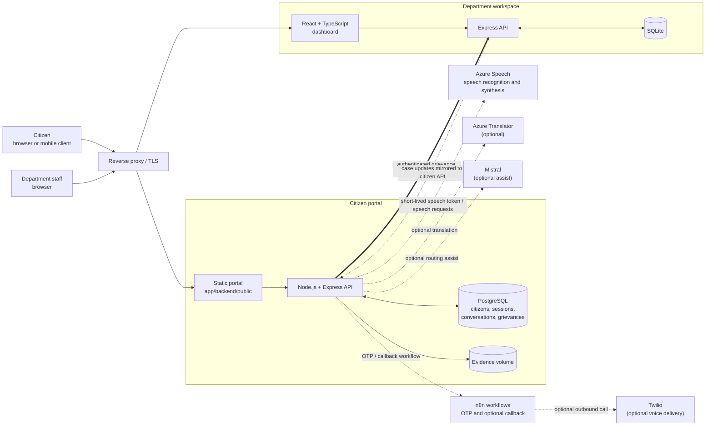
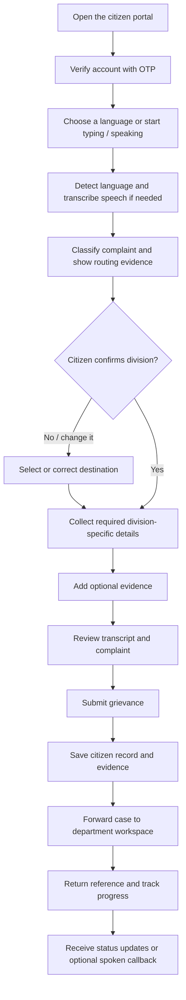

# MHA Samadhan

> **A multilingual, voice-first grievance filing and tracking prototype.**
> MHA Samadhan helps citizens describe a concern in their own language, guides
> them through filing, routes it to a relevant department, and provides a
> separate workspace for staff to review and act on cases.

**Project demo:** [hacknovate2026.visioncoders.in](https://hacknovate2026.visioncoders.in)<br>
**Repository:** [Eggyak/Hacknovate2026](https://github.com/Eggyak/Hacknovate2026)

> **Prototype notice:** This is an independent hackathon project, not an
> official Ministry of Home Affairs service. Do not enter real citizen
> personal, financial, or sensitive information.

## Table of contents

- [Project at a glance](#project-at-a-glance)
- [What the system does](#what-the-system-does)
- [System architecture](#system-architecture)
- [Citizen grievance flow](#citizen-grievance-flow)
- [Language and routing pipeline](#language-and-routing-pipeline)
- [Technology stack](#technology-stack)
- [Repository map](#repository-map)
- [Run locally](#run-locally)
- [Configuration](#configuration)
- [API overview](#api-overview)
- [Testing](#testing)
- [Operations and further documentation](#operations-and-further-documentation)
- [Security and privacy notes](#security-and-privacy-notes)

## Project at a glance

MHA Samadhan is made up of two related but independently operated portals:

| Portal | Audience | Application | Data store |
| --- | --- | --- | --- |
| Citizen portal | Citizens filing and tracking grievances | Static web client served by the Node.js API | PostgreSQL |
| Department workspace | Staff reviewing and processing cases | React/TypeScript dashboard with an Express API | SQLite |

The portals use separate identities and databases. A server-to-server intake
integration forwards filed cases to the department workspace; staff-side
outages do not have to take down the citizen filing experience.

## What the system does

### Citizen portal

- Supports typed and spoken grievance intake in 14 languages.
- Uses an OTP-based citizen sign-in flow.
- Detects typed language locally from writing system and language markers.
- Uses Azure Speech for browser speech recognition and speech playback when
  configured. The browser receives a short-lived speech token rather than an
  Azure subscription key.
- Classifies complaints against 15 modeled MHA divisions, with an additional
  “Other” triage destination. Routing uses language-specific keywords first
  and can use Mistral as an optional assist.
- Collects division-specific details and supporting evidence through a
  conversational filing flow.
- Creates grievance references, tracks case state and due dates, and provides
  public status-only tracking.
- Includes civic transparency and community features such as map/heatmap
  views, similar-case discovery, support, comments, and ratings.
- Can optionally request a spoken status callback to the citizen’s registered
  phone number.

### Department workspace

- Provides a React and TypeScript dashboard backed by an Express API and
  SQLite.
- Supports staff authentication, role and permission administration, and
  department-scoped queues.
- Models 15 divisions plus an “Other Cases Triage” queue.
- Supports ticket review, status updates, action reports, routing, and
  ward/division scope restrictions.
- Receives citizen filings over an authenticated service-to-service intake
  integration.

### Capabilities are reported, not assumed

Optional integrations are deliberately configurable. The citizen API exposes
health and mobile-manifest endpoints so clients can check whether speech,
translation, assisted routing, OTP delivery, and callbacks are enabled on a
particular deployment. If a cloud provider is unavailable or not configured,
the affected capability should be surfaced as unavailable rather than
presented as if it succeeded.

## System architecture



The citizen and staff systems have separate authentication models and storage.
The integration between them is intentionally narrow: grievance intake and
case-status synchronization, rather than shared user accounts or a shared
database.

## Citizen grievance flow



The conversation and submission behavior are implemented in the API, not
delegated to an unconstrained chatbot. Citizens can inspect and correct the
transcribed complaint and routing before submission.

## Language and routing pipeline

The pipeline is intentionally composed of inspectable steps:

```mermaid
flowchart LR
    Input["Typed text or microphone audio"]
    Input --> Identify{"Input mode"}
    Identify -- "Typed" --> LocalDetect["Local script + marker-lexicon detection"]
    Identify -- "Speech" --> SpeechToken["Request short-lived Azure Speech token"]
    SpeechToken --> Speech["Browser speech recognition"]
    Speech --> Transcript["Transcript + detected language"]
    LocalDetect --> Transcript
    Transcript --> Route["Multilingual division keyword scoring"]
    Route --> Assist{"Optional Mistral assist configured?"}
    Assist -- "Yes, when needed" --> Settle["Use assist to resolve uncertain routing"]
    Assist -- "No / not needed" --> Confirm["Show proposed division and evidence"]
    Settle --> Confirm
    Confirm --> Translate["Optional English rendering"]
    Confirm --> File["Continue intake in citizen language"]
    Translate --> File
```



### Supported languages

English, Hindi, Bengali, Tamil, Telugu, Marathi, Gujarati, Kannada,
Malayalam, Punjabi, Odia, Assamese, Urdu, and Nepali.

The language catalog includes Azure speech locales and neural voice choices.
Azure continuous language identification has a per-request candidate limit;
the service narrows the candidate set using the citizen’s selected language,
common link languages, and locale information where available. Odia and
Assamese remain available for speech input, although automatic speech-language
identification is not enabled for those locales.

**Routing does not depend on translation.** Its language-specific lexicons
allow complaints to be routed in their original script. Translation is an
optional English rendering step, not a prerequisite for filing.

## Technology stack

| Layer | Technologies |
| --- | --- |
| Citizen UI | HTML, CSS, browser JavaScript |
| Citizen API | Node.js 20+, Express |
| Citizen database | PostgreSQL 16 |
| Staff UI | React, TypeScript, Vite, Tailwind CSS |
| Staff API | Node.js, Express |
| Staff database | SQLite via `better-sqlite3` |
| Speech | Microsoft Azure Speech SDK and browser speech APIs |
| Translation | Azure Translator (optional) |
| Optional routing assistance | Mistral API |
| OTP and callback workflows | n8n; Twilio for optional voice callbacks |
| Deployment | Docker Compose, persistent volumes, reverse proxy integration |

## Repository map

```text
.
├── app/backend/
│   ├── public/                 Citizen portal HTML, CSS, and JavaScript
│   ├── src/routes/             HTTP API routes
│   ├── src/services/           Intake, routing, speech, OTP, and integrations
│   ├── src/data/               Languages, divisions, states, and phrases
│   ├── src/lib/                Database, auth, environment, migrations
│   ├── migrations/             PostgreSQL schema migrations
│   └── test/                   API, UI, routing, and language tests
├── govt/
│   ├── src/                    React and TypeScript staff dashboard
│   ├── server/                 Staff Express API and SQLite data access
│   └── scripts/                Integration checks
├── docs/                       Operations, Android, and callback guides
├── n8n/                        OTP workflow and installation helper
├── ops/n8n/                    Spoken callback workflow definition
├── docker-compose.yml          API, PostgreSQL, and staff workspace services
└── .env.example                Environment variable template
```

## Run locally

### Prerequisites

- Node.js 20 or newer.
- npm.
- PostgreSQL 16 for the citizen API.
- Docker Compose for the containerized stack.
- Optional provider credentials for Azure Speech, Azure Translator, Mistral,
  n8n, or Twilio features.

### Citizen API

1. Copy `.env.example` to `.env` and set database credentials and a strong
   `JWT_SECRET`. Keep `.env` local; it is ignored by Git.
2. Provide a reachable PostgreSQL instance and configure `DATABASE_URL` (or
   the equivalent database settings supported by the API environment loader).
3. Install dependencies, apply migrations, and start the API:

```powershell
cd app/backend
npm install
npm run migrate
npm run dev
```

The API listens on the configured `PORT` (8120 in the Compose deployment).
Its citizen portal is served by the API. Check `GET /api/health` to see
database and optional provider status.

### Department workspace

In another terminal:

```powershell
cd govt
npm install
npm run start:local
```

The Vite UI is served at `http://localhost:5173`; its development proxy
forwards `/api` requests to the staff API at `127.0.0.1:3001`. The first
startup initializes the local SQLite database. See [govt/README.md](govt/README.md)
for staff setup, access controls, and workspace-specific details.

### Docker Compose deployment

The root `docker-compose.yml` runs the citizen API, PostgreSQL, and department
workspace with persistent database and evidence volumes. It is configured for
the project deployment and expects external `edge` and `n8n-kmar_default`
networks to exist. Configure the environment and those networks for your
target host before running:

```powershell
docker compose up -d --build
docker compose ps
```

Do not treat the deployment Compose file as a fully self-contained local
development environment; the external networks and optional integrations
must be considered.

## Configuration

Start from [.env.example](.env.example). Never commit populated `.env` files,
provider keys, database passwords, or JWT secrets.

| Variable | Purpose |
| --- | --- |
| `PUBLIC_URL` | Public base URL used when constructing links and callbacks |
| `POSTGRES_USER`, `POSTGRES_PASSWORD`, `POSTGRES_DB` | PostgreSQL container credentials |
| `JWT_SECRET` | Signs citizen session tokens; use a long random value |
| `AZURE_SPEECH_KEY`, `AZURE_SPEECH_REGION`, `AZURE_SPEECH_ENDPOINT` | Azure Speech integration |
| `AZURE_TRANSLATOR_KEY`, `AZURE_TRANSLATOR_REGION` | Optional Azure Translator integration |
| `MISTRAL_API_KEY`, `MISTRAL_MODEL` | Optional routing assistance and translation fallback |
| `SLA_DAYS` | Grievance due-date interval; defaults to 21 |
| `GOVT_API_URL`, `MHA_INTAKE_SERVICE_KEY` | Staff-workspace intake integration |
| `MHA_STAFF_ACCESS_KEY` | Optional staff access-key configuration |
| `N8N_OTP_WEBHOOK_URL`, `N8N_OTP_API_KEY` | OTP delivery workflow |
| `N8N_CALLBACK_WEBHOOK_URL`, `TWILIO_FROM_NUMBER`, `CALLBACK_SHARED_SECRET` | Optional spoken status callback |
| `UPLOAD_DIR` | Persistent location for uploaded evidence |

Unset optional provider values disable their dependent capability; they do
not make the application credentials public or substitute a successful
response. Consult [docs/OPERATIONS.md](docs/OPERATIONS.md) and
[docs/SPOKEN_CALLBACK.md](docs/SPOKEN_CALLBACK.md) before configuring a
deployment.

## API overview

The citizen API is mounted in `app/backend/src/server.js`. Most endpoints
require an appropriate citizen session; see the route handlers for exact
authentication, rate-limit, and payload requirements.

| Prefix | Purpose | Representative routes |
| --- | --- | --- |
| `/api/health` | Dependency health | `GET /api/health` |
| `/api/auth` | Citizen OTP sign-in and profile | `POST /start`, `POST /verify`, `GET /me`, `PATCH /profile`, `POST /signout` |
| `/api/chat` | Guided filing conversation | `POST /start`, `POST /:id/message`, `PATCH /:id/draft`, `POST /:id/submit` |
| `/api/speech` | Speech capabilities and synthesis | `GET /token`, `GET /languages`, `POST /speak`, `POST /transcribe` |
| `/api/grievances` | Citizen cases, tracking, evidence, notifications | `GET /divisions`, `GET /track/:reference`, `GET /:reference` |
| `/api/i18n` | Translation support | See `app/backend/src/routes/i18n.js` |
| `/api/mobile` | Client manifest and citizen session view | `GET /manifest`, `GET /session` |
| `/api/civic` | Civic transparency and community features | `GET /map`, `GET /heatmap`, `GET /transparency` |
| `/api/calls` | Spoken status callback workflow | `GET /options`, `POST /request`, `POST /cancel` |

The staff API is implemented separately under `govt/server/`. Its staff
authentication, roles, permissions, and ticket endpoints are documented in
[govt/README.md](govt/README.md).

## Testing

Run the citizen backend test suite:

```powershell
cd app/backend
npm test
```

The backend tests cover import integrity, routing/classification, language
detection, and selected API/UI behavior. Some integration tests require the
configured database or service environment; consult individual test files
before pointing them at any non-test deployment.

Run staff role-boundary integration tests:

```powershell
cd govt
npm install
npm run test:rbac
```

Build the staff dashboard:

```powershell
cd govt
npm run build
```

## Operations and further documentation

- [Department workspace guide](govt/README.md) — staff setup, role model,
  ticket behavior, and staff API.
- [Operations guide](docs/OPERATIONS.md) — deployment, health checks, OTP,
  backups, and operational cautions.
- [Android client guide](docs/ANDROID_APP.md) — portal manifests, API
  contracts, and mobile client behavior.
- [Spoken callback guide](docs/SPOKEN_CALLBACK.md) — optional n8n/Twilio
  callback configuration and safeguards.
- [OTP workflow](n8n/MHA_Samadhan_OTP.json) — n8n workflow definition.
- [Callback workflow](ops/n8n/mha-status-callback.json) — optional voice
  callback workflow definition.

## Security and privacy notes

- Keep all credentials in environment variables or a deployment secret store;
  never put them in source control or client-side code.
- Citizen and staff sessions are separate. Do not reuse tokens or identity
  records between the two systems.
- Public grievance tracking is intended to expose status and dates only, not
  grievance text or personal details.
- Sensitive identifiers are handled by the application before persistence;
  verify the current implementation and deployment configuration before
  processing any real data.
- Spoken callbacks use the phone number already associated with the citizen
  account and avoid reading the grievance narrative aloud.
- This repository is a hackathon prototype. A production deployment requires
  an independent security, privacy, accessibility, legal, and operational
  review.
